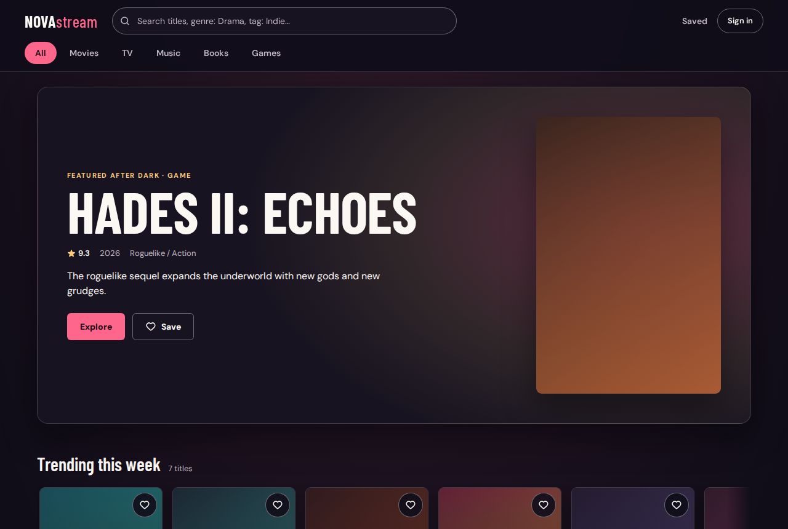
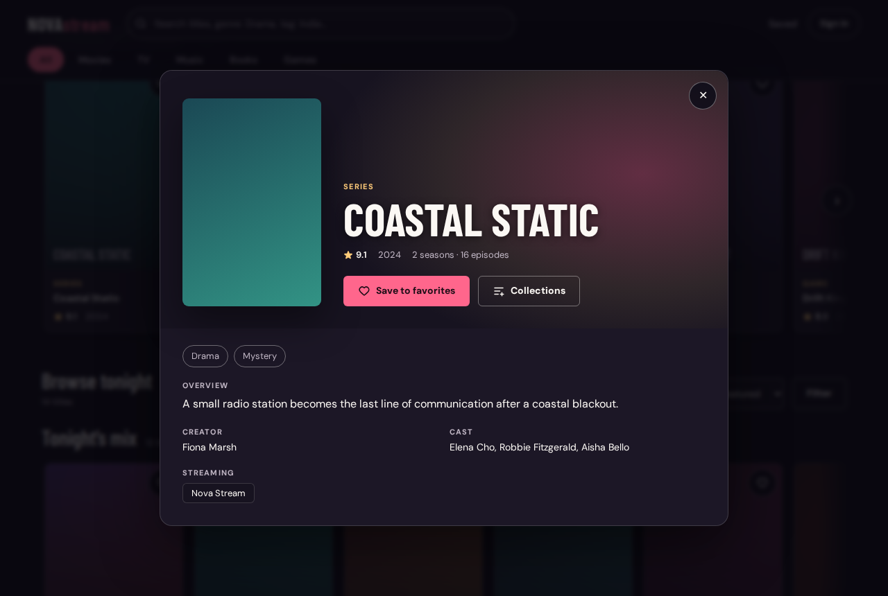
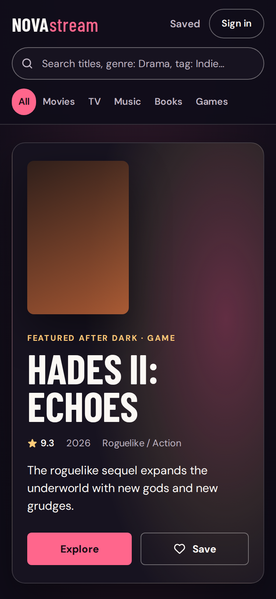

# Nova Stream

One place to discover films, series, music, books and games: search or browse all five
formats, open a title's details, and save it to favorites or your own collections. It's
built for casual browsing before deciding what to watch, read, play or hear.

**Live: [nova-stream-theta.vercel.app](https://nova-stream-theta.vercel.app/)**

| Home (desktop)                                                                          | Title detail                                                                | Home (phone)                                       |
| --------------------------------------------------------------------------------------- | --------------------------------------------------------------------------- | -------------------------------------------------- |
|  |  |  |

Screenshots are from mock mode, whose bundled titles use generated artwork. The live site
shows the providers' posters and covers, and opens on trending and favorites rather than
the spotlight.

## Features

- **Search and browse:** all five formats from one box (Ctrl+K or Cmd+K), or pick a type. `genre: Drama`
  and `tag: Indie` search by genre or tag.
- **Filter and sort:** categories, per-type genres, music kind, minimum rating and plays; sort
  by best match, top rated, newest or A–Z.
- **Home:** a "Trending this week" shelf and your favorites. Mock mode adds a featured spotlight
  and cross-media shelves.
- **Title detail:** synopsis, rating, creator and cast, streaming providers, tracklists and play
  counts, episodes by season, an artist's albums, full-size artwork, and chips that start a new search.
- **Favorites and collections:** save as a guest or on your account. Built-in status collections
  (To Watch, Read, Playing, …) plus your own, each limited to chosen formats. Guest saves move
  to the account on sign-in.
- **Accounts:** register, sign in, change your password, or delete the account and its data.
- **Languages:** English, European Portuguese, Spanish and French, picked in the header. TMDb
  titles and synopses follow the choice; other providers' data stays in English.
- **Installable:** a service worker caches the app shell only, and a new deploy takes over on the
  next load.
- **Accessible and responsive:** works at 375, 768 and 1280px, with keyboard access, visible focus,
  a skip link and reduced-motion support.

## Stack

React 18, TypeScript and Vite on the frontend, with i18next and `vite-plugin-pwa`. An Express 4
API proxies TMDb, RAWG, Last.fm, Deezer and Open Library, and keeps accounts in Upstash Redis or
a local JSON file. It runs on Vercel as a static site plus one serverless function.

## Engineering highlights

- **Partial failure is a normal response:** each provider is searched in parallel with its own
  timeout, and a failed one is reported per type while the others still return results
  (`server/src/services/searchAcross.js`).
- **Password attempts can't race the limit:** each attempt is counted atomically before bcrypt
  runs, and unknown emails still cost one compare, so timing doesn't reveal accounts
  (`server/src/db/attempts.js`, `server/src/routes/auth.js`).
- **Data writes can't undo a password change:** credentials live under their own key, so a save
  that read the user before the change can't restore the old hash (`server/tests/db/store.test.js`).
- **Missing translations fail the build:** catalogs are typed against English, and tests check that
  each locale has every key and components carry no literal copy (`src/i18n/`).

## Run it

Requires Node.js 22 or newer and npm. Mock mode needs no keys or API:

```bash
cp .env.example .env
npm install
npm run dev             # http://localhost:5173
```

For accounts and live data, run the API in a second terminal:

```bash
cd server
cp .env.example .env    # set JWT_SECRET and any provider keys
npm install
npm run dev             # http://localhost:4000
```

Then set `VITE_USE_MOCK=false` in the root `.env` and restart the frontend. Variables and
provider keys are listed under [Configuration](docs/ARCHITECTURE.md#configuration).

| Command           | What it does                                                       |
| ----------------- | ------------------------------------------------------------------ |
| `npm test`        | Frontend and API tests                                             |
| `npm run lint`    | Lint with oxlint                                                   |
| `npm run format`  | Format with oxfmt (`format:check` only reports)                    |
| `npx tsc -b`      | Typecheck                                                          |
| `npm run build`   | Typecheck and build into `dist/`                                   |
| `npm run preview` | Serve the build, with its service worker, at http://localhost:4173 |

## Documentation

- [Architecture](docs/ARCHITECTURE.md): how the parts fit together, API contracts, data, configuration,
  testing and known limitations.
- [Deployment](docs/DEPLOYMENT.md): first deploy to Vercel, release checks and other hosts.

## Licence and credits

[MIT](LICENSE). The licence covers this repository's code, not the data, artwork or trademarks of
the providers below.

Built by [Tiago Espadinha](https://personal-portfolio-three-hazel-61.vercel.app/). Data comes from
[TMDB](https://www.themoviedb.org/), [RAWG](https://rawg.io/), [Last.fm](https://www.last.fm/),
[Deezer](https://www.deezer.com/) and [Open Library](https://openlibrary.org/), and remains subject
to their terms.
