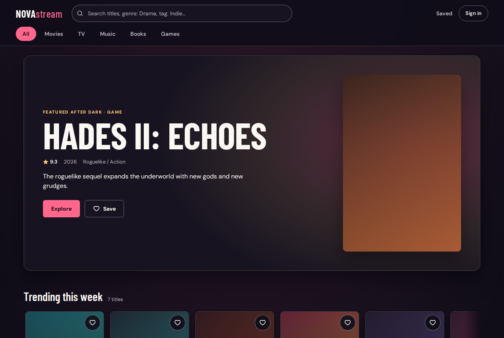
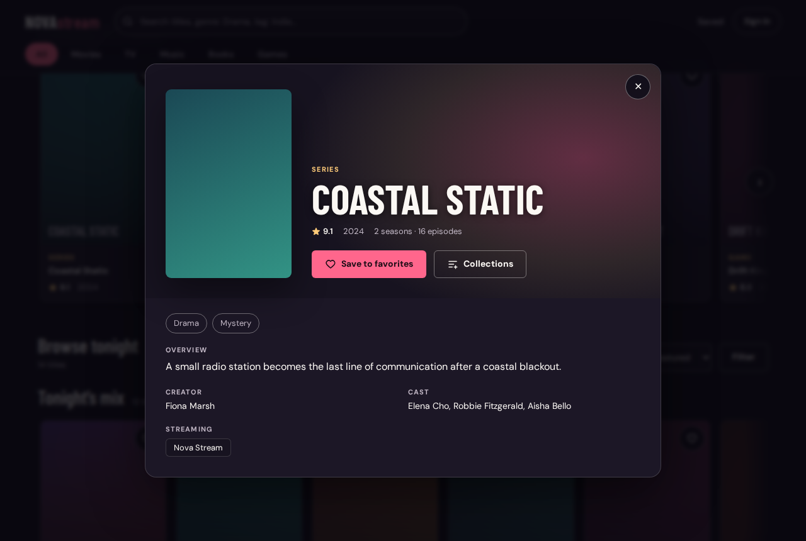
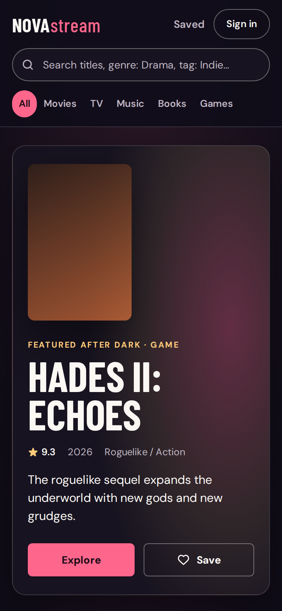

# Nova Stream

One place to discover films, series, music, books, and games: search or browse across all
five formats, open a title's details, and save it to favorites or your own collections.
It's built for casual browsing before deciding what to watch, read, play, or hear.

Nova Stream is a **local prototype**: a React + TypeScript + Vite frontend and a small
Express API (in `server/`) that proxies free-tier metadata providers and stores accounts in
a JSON file. It is not production-hardened; see [Known limitations](#known-limitations).

| Home (desktop) | Title detail | Home (phone) |
|---|---|---|
|  |  |  |

Screenshots are from mock mode, whose bundled titles use generated gradient artwork; live
mode shows the providers' posters and covers.

## Features

- **Search and browse** all five formats from one box, or pick a type (All, Movies, TV,
  Music, Books, Games). `genre: Drama` and `tag: Indie` search by genre or tag.
- **Filter and sort**: categories, per-type genres, music kind (albums, songs, artists),
  minimum rating, minimum plays; sort by best match/featured, top rated, newest, or A–Z.
- **Home**: a "Trending this week" shelf and your favorites; in mock mode also a featured
  spotlight and cross-media shelves (shelves scroll with arrows, keyboard, touch, or Shift + wheel).
- **Title detail**: synopsis, rating, year, runtime, creator and cast, streaming providers
  (films and TV), tracklist and play counts (music), full-size artwork, and genre/tag chips
  that start a new search.
- **Favorites and collections**: save without an account (kept in this browser), or sign in
  to keep them on your account. Built-in status collections (To Watch/Watched, To Read/Read,
  To Listen/Listened, To Play/Playing/Played) plus your own, each limited to chosen formats. On
  sign-in, guest favorites and collections move to the account.
- **Saved page** (`/saved`) to revisit favorites and manage collections.
- **Accounts**: register and sign in (email + password).
- **Languages**: English, European Portuguese, Spanish and French, picked in the header. The
  choice is remembered; a first visit follows the browser language. TMDb titles and synopses
  follow it too; RAWG, Last.fm and Open Library data stays in English.
- **Installable** as an app (Chrome, Edge, Android) from the production build. A service
  worker caches the app shell only; API data, fonts, and artwork always come from the
  network, and a new deploy takes over on the next load.
- Responsive at 375, 768, and 1280px; keyboard accessible with visible focus, a skip link,
  and reduced-motion support.

## Mock vs. live data

The frontend runs **with or without** the API, controlled by `VITE_USE_MOCK` in the root
`.env`:

- `VITE_USE_MOCK=true` (default): a bundled dataset (`src/data/mockData.ts`) powers search,
  detail, and the trending shelf. No API calls are made for those. Saving as a guest works;
  signing in still needs the API.
- `VITE_USE_MOCK=false`: search, detail, and trending call the API. Live mode never falls
  back to mock data. If the API is unreachable or a provider isn't configured, the UI says
  so and offers a retry where one can help.

## Quick start

### Prerequisites

- **Node.js 22 or newer** and npm. The server's test runner uses glob patterns
  (Node 21+), and Node 18 and 20 are past end of life. Developed on Node 26.
- Two terminals: one for the API, one for the frontend.

### 1. Frontend only (mock mode, no keys needed)

```bash
cp .env.example .env    # VITE_USE_MOCK=true by default
npm install
npm run dev             # http://localhost:5173
```

### 2. API (for accounts and live data)

```bash
cd server
cp .env.example .env    # then set JWT_SECRET and any provider keys, see below
npm install
npm run dev             # http://localhost:4000
```

Generate a `JWT_SECRET` (accounts stay switched off until one is set):

```bash
node -e "console.log(require('crypto').randomBytes(32).toString('hex'))"
```

Then set `VITE_USE_MOCK=false` in the root `.env` and restart `npm run dev` to switch to
live data.

### Environment variables

The frontend reads the root `.env`; the API reads `server/.env`. Names and defaults come
from the two `.env.example` files.

| Variable | Where | Default | Purpose |
|---|---|---|---|
| `VITE_API_BASE_URL` | root | `http://localhost:4000/api` | API base URL |
| `VITE_USE_MOCK` | root | `true` | `false` switches to live data |
| `PORT` | server | `4000` | API port |
| `CORS_ORIGIN` | server | `http://localhost:5173` | The only browser origin the API accepts |
| `JWT_SECRET` | server | empty | Signs session tokens; accounts answer 503 until set |
| `JWT_EXPIRES_IN` | server | `7d` | Session length |
| `PASSWORD_ATTEMPTS_PER_ACCOUNT`, `PASSWORD_ATTEMPTS_PER_IP`, `PASSWORD_ATTEMPT_WINDOW_SECONDS` | server | `5`, `20`, `900` | Failed password attempts allowed per account and per IP before sign-in, password change and account deletion answer 429 for the rest of the window |
| `SIGNUP_ATTEMPTS_PER_IP`, `SIGNUP_ATTEMPT_WINDOW_SECONDS` | server | `10`, `3600` | Sign-ups allowed per IP (new or taken email) before sign-up answers 429 for the rest of the window |
| `TMDB_API_KEY` | server | empty | Films and TV |
| `RAWG_API_KEY` | server | empty | Games |
| `LASTFM_API_KEY` | server | empty | Music |
| `NODE_ENV` | server | unset | `production` turns off the request/response logging below |
| `UPSTASH_REDIS_REST_URL`, `UPSTASH_REDIS_REST_TOKEN` | server | empty | Store users in Upstash Redis instead of the local JSON file (needed on Vercel). `KV_REST_API_URL`/`KV_REST_API_TOKEN` also work |

A provider without a key doesn't break anything: its type is reported as "not set up"
while the other types still return results.

### Getting provider keys

| Provider | Used for | Key |
|---|---|---|
| [TMDb](https://www.themoviedb.org/settings/api) | Films and TV: search, detail, watch providers, weekly trending | Free, instant; attribution required |
| [RAWG](https://rawg.io/apidocs) | Games: search, detail, platforms; "trending" is games added in the last 30 days | Free, 20k requests/month; attribution required (see limitations) |
| [Last.fm](https://www.last.fm/api/account/create) | Music: albums, songs, artists, play counts, top-tracks chart | Free; credit requested |
| [Deezer](https://developers.deezer.com/api) | Music: artist photos (Last.fm only serves a placeholder) and release years | None needed; terms limit use to non-commercial, private use (see limitations) |
| [Open Library](https://openlibrary.org/developers/api) | Books: search, detail, weekly trending | None needed |

### Production build

```bash
npm run build            # type-checks, then builds the frontend into dist/
npm run preview          # serves dist/ at http://localhost:4173
```

The preview registers the service worker (the dev server does not). To see a new build
after a rebuild, reload once; to start clean, clear site data in DevTools > Application.

Run the API separately in another terminal with `cd server && npm start`. In live mode, set
`CORS_ORIGIN=http://localhost:4173` in `server/.env` while using the preview.

### Deploying to Vercel (free tier)

`vercel.json` builds the frontend into `dist/` and serves the API as one serverless
function (`api/index.js`, the same Express app) on the same origin, so CORS isn't involved.
Vercel's filesystem doesn't keep writes, so accounts need a free Upstash Redis database.

1. Import the repository into a new Vercel project on the Hobby plan; keep the root
   directory and the settings `vercel.json` provides.
2. In the project, **Storage → Upstash for Redis → Free**, and connect it. This adds the
   `KV_REST_API_*`/`UPSTASH_REDIS_REST_*` variables the API reads.
3. Add the remaining variables for Production and Preview: `VITE_USE_MOCK=false`,
   `VITE_API_BASE_URL=/api`, a newly generated `JWT_SECRET`, `JWT_EXPIRES_IN` (optional),
   `TMDB_API_KEY`, `RAWG_API_KEY`, `LASTFM_API_KEY`.
4. Deploy. Check `https://<your-app>.vercel.app/api/health` returns `{"ok":true}`.

Accounts in a local `data.json` aren't copied to Redis.

## Checks

| Check | Command |
|---|---|
| Frontend tests (Vitest) | `npx vitest run` |
| Server tests (`node --test`) | `cd server && npm test` |
| Typecheck | `npx tsc -b` |
| Frontend build | `npm run build` |

There is no lint script, E2E suite, or CI.

## Troubleshooting

- **Still seeing the sample titles (gradient artwork) after switching to live**:
  `VITE_USE_MOCK` must be exactly `false` in the root `.env`. Restart `npm run dev`; Vite
  reads `.env` at startup.
- **"Accounts aren't set up on the server yet"**: `JWT_SECRET` is empty in `server/.env`.
- **A type says it isn't set up**: its provider key is missing in `server/.env`.
- **CORS errors in the browser**: `CORS_ORIGIN` must match the frontend's exact origin, and
  the API accepts only one origin at a time.
- **Testing from a phone or another device**: run `npm run dev -- --host`, then set
  `VITE_API_BASE_URL=http://<your-LAN-IP>:4000/api` in the root `.env` and
  `CORS_ORIGIN=http://<your-LAN-IP>:5173` in `server/.env`, and restart both.
- **Signed out unexpectedly**: sessions end after `JWT_EXPIRES_IN`, or when `JWT_SECRET`
  changes. Sign in again.

## API

All routes are under `/api`. Search, detail, and trending are public; account routes need
`Authorization: Bearer <token>`. Full contracts are in
[`docs/ARCHITECTURE.md`](docs/ARCHITECTURE.md).

| Route | Purpose |
|---|---|
| `GET /health` | Liveness check |
| `GET /search?q=&type=&musicKind=&lang=` | Search one type or `all`; per-provider errors are reported without failing the request |
| `GET /trending?lang=` | Up to 4 items per type, cached in memory for 6 hours |
| `GET /media/:type/:id?lang=` | Full detail for one title; `lang` (`en`, `pt-PT`, `es`, `fr`) localizes TMDb titles |
| `POST /auth/register`, `POST /auth/login` | Create an account or sign in; returns a JWT |
| `GET /auth/me`, `PATCH /auth/preferences` | Current user; preferences |
| `GET /saved`, `POST /saved`, `DELETE /saved/:id` | Favorites (up to 500) |
| `GET /collections`, `PUT /collections` | The user's collections document |

Accounts, favorites, and collections are read and written only through
`server/src/db/store.js`: in Upstash Redis when its variables are set, otherwise in
`server/src/db/data.json` (git-ignored).

Outside production, the API logs every request and response to the console, with
credentials, tokens, and API keys redacted.

## Project structure

```
src/                    frontend
├── components/         Header, Spotlight, Shelf, ContentCard, MediaDetail, FilterDialog,
│                       SavedPage, LoginModal, CollectionMenu, AccountNotices, …
├── context/            AuthContext (session and token)
├── hooks/              useFavorites, useCollections, useTrending, useDialog
├── services/           apiService.ts, the only module that calls the API
├── data/               mockData.ts (mock mode)
├── styles/             tokens.css (design tokens), index.css
├── utils/              filtering, discovery shelves, collections, error copy
└── App.tsx, config.ts, types.ts

server/src/
├── routes/             search, trending, media, auth, saved, collections
├── services/           tmdb, rawg, lastfm, openLibrary, trending, searchAcross, providerError
├── middleware/         auth (JWT)
├── db/                 store.js (Upstash Redis or JSON-file store)
├── utils/              validate (input at the boundary), password (bcrypt), asyncRoute
├── app.js              the Express app
└── index.js            local server (listen)

api/index.js            Vercel function serving server/src/app.js

docs/                   brief, design direction, UX flows, architecture
```

## Known limitations

This is a local prototype. Before any public deployment:

- **Provider attribution**: RAWG's free tier requires a visible link to RAWG wherever its
  game data appears, TMDb's terms require its logo and a not-endorsed notice, and Last.fm
  asks for a credit. The footer links each provider and shows TMDb's notice, but not
  yet TMDb's logo.
- **Deezer's terms**: Deezer's API terms allow only non-commercial, "strictly private use
  within a family scope" and protect artist photos. The app uses Deezer anyway as a
  non-commercial portfolio project; a public or commercial deployment would need Deezer's
  approval or another source for photos and release years.
- **Rate limiting covers passwords only**: failed password attempts are limited per account
  and per IP (in Redis when it's configured, otherwise in the API process's memory), but the
  public search, detail, and trending routes spend your provider quotas for anyone who can
  reach the API. The client IP comes from `x-forwarded-for` only on Vercel; behind any other
  proxy every visitor shares the proxy's address, so the per-IP limit applies to all of them
  together.
- **Sessions**: the JWT is kept in `localStorage` (readable by any script on the page) and
  can't be revoked before it expires.
- **Storage**: a whole user record is rewritten on every change (last write wins), with no
  backups or migrations. The local JSON file suits a single process only.
- **Providers**: timeouts (8s) stop waiting but don't cancel the underlying request; Open
  Library's trending feed is undocumented and may change; the trending cache lives in
  memory and is lost on restart.
- **Fonts** load from Google Fonts; how they should be delivered in a real build is
  undecided.
- **Accessibility** was checked with scripted keyboard, focus, contrast, and layout tests,
  not with a screen reader.
- **Mock mode** has only 2–3 titles per type, and its music titles have no kind, so the
  music-kind filter does nothing there. The spotlight and cross-media shelves are
  mock-only: live mode shows trending and favorites before a search and a results grid
  after.
- **Testing**: the frontend has unit tests for utilities only (no component or hook tests),
  there's no E2E suite or CI, and browser checks so far are ad hoc scripts.
